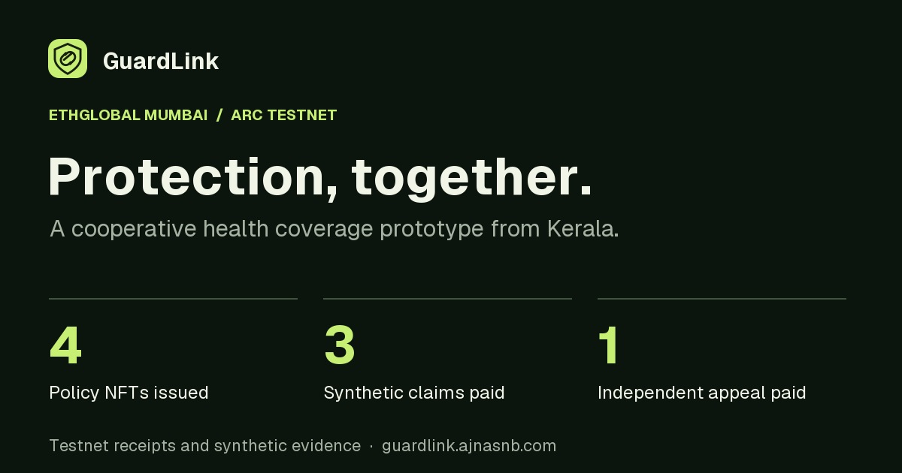
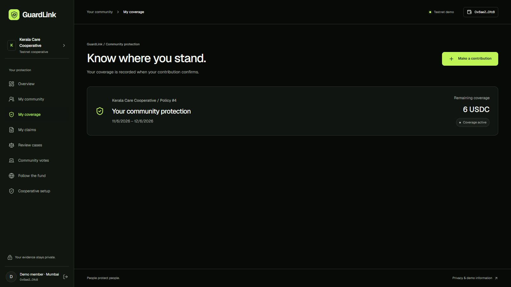
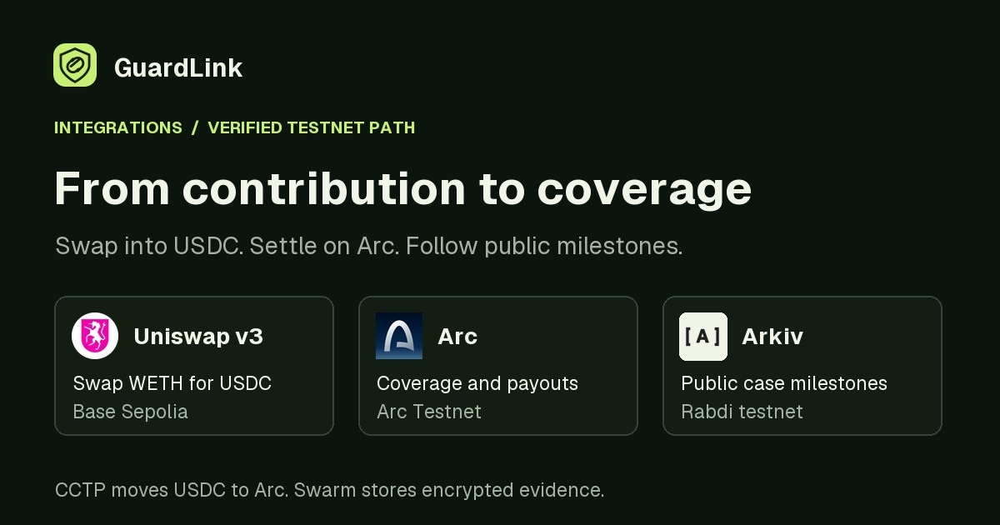

# GuardLink · Protection, together



GuardLink is a cooperative health coverage prototype inspired by a personal experience in Kerala. After his father's eye surgery, the founder's family borrowed while waiting for reimbursement. A year of conversations with families and people connected to Kudumbashree shaped the product around three questions a member should be able to answer. What does my policy cover? Why was my claim decided this way? Where did the payment go?

[Open GuardLink](https://guardlink.ajnasnb.com/) · [Public event source](https://github.com/AjnasNB/GuardLink) · [Arc Studio workspace](https://studio.arc.io/app/5b1cd267-eb2b-4f67-82cf-0f0d2b15252d) · [Architecture diagram](docs/ethglobal/ARCHITECTURE.md) · [Judge handoff](docs/ethglobal/SUBMISSION_HANDOFF.md)

The Cloudflare backend is available at [api.guardlink.ajnasnb.com](https://api.guardlink.ajnasnb.com/health). The web app proxies its own `/api/v1/` requests to the API Worker through a service binding so browser sessions stay on the web domain.

**Environment** Arc Testnet, synthetic medical documents and test USDC. This prototype does not sell real insurance.

## Try it as a member

1. Sign in with a separate Arc Testnet wallet. Open **My community → Kerala Care Cooperative**.
2. Read and accept the eligibility criteria. Request membership and confirm wallet registration. The cooperative operator reviews the request and verifies the wallet on Arc.
3. Refresh membership status. Approve and contribute **1 test USDC** from the same wallet. Open **My coverage** after confirmation. The pool issues a non-transferable policy NFT for **30 days** with a **6 test USDC** limit under current rules.
4. Submit a synthetic claim against that policy. Use the same claim ID to respond to any missing-document request. Authorized jurors review the private evidence and vote. Two matching votes establish a decision and, for approvals, the payout amount.
5. Open the claim to see its decision and payment link. A rejected claim can be appealed once to a different panel. Use **Follow the fund** to query public milestones.



The fresh-wallet run checked the live API at each step, verified exactly 1 test USDC entering the pool, and checked NFT ownership on Arc and Policy #4 in the app. [Registration](https://testnet.arcscan.app/tx/0xa4d85966414f620d1a9963343cde8a414c193b71c9acc17793bf3c471f2dcd75) · [Operator verification](https://testnet.arcscan.app/tx/0xc0adce4f8d3a64f5d224218cf46a1c9874466c42bd62cf5bd1650beb72229e17) · [Contribution and mint](https://testnet.arcscan.app/tx/0xaec9d1fe84e65088f254b579f2d0025f976efc5008e31e09bc60db5478935ee1) · [Complete run](docs/ethglobal/membership-live.public.json)

## Who controls what?

| Action | Authority |
| --- | --- |
| Edit cooperative description and joining criteria | The cooperative operator edits the profile. The app records which criteria the applicant accepted. |
| Verify a member or appoint a claim panel | The designated operator signs on Arc. The pool enforces eligibility, excludes conflicts it can identify, and requires a separate appeal panel. |
| Add a policy for a member | A verified member signs a contribution. The pool mints the NFT to that wallet using current terms. |
| Change policy terms for future members and contributions | Verified members propose and vote on contribution, limit and term. Executed changes apply to future policies. An existing policy keeps its original terms. |
| Review evidence and resolve a claim | The AI evidence assistant prepares findings and flags missing items. Eligible human jurors sign the votes. The contract authorizes settlement after the required votes. |

The current demo runs one configured cooperative pool. Its policy terms form one active set per pool, with historical versions preserved in issued NFTs. The app currently has no product catalog for multiple simultaneous coverage tiers.

## Verified demo milestones

- **Enrollment:** Four policy NFTs across the current Arc deployment, including the optional swap-funded policy and the fresh-wallet enrollment.
- **Evidence assistant:** On three authenticated, paid synthetic cases, the live API returned completed model recommendations. Case C returned five findings after a missing prescription was supplied under the same claim ID. This audit re-read those completed runs.
- **Decisions and payments:** Initial claims paid 0.50 and 0.25 test USDC. An independent appeal paid 0.40 test USDC. The audit matched recipients, amounts and claim IDs to chain receipts.
- **Governance:** Nine demo wallets voted to raise future coverage from 5 to 6 test USDC. The earlier policy retained its original 5 test USDC limit.
- **Privacy:** Assigned reviewers could retrieve evidence. Cross-member and unassigned-helper reads were denied. Public projections omit medical evidence and member identity.

[Live audit](docs/ethglobal/live-verification.json) · [Claim and governance receipts](docs/ethglobal/demo-run.public.json) · [Contract source verification](docs/ethglobal/source-verification.json)

## How the integrations fit



| Integration | What it does | How to check |
| --- | --- | --- |
| **Arc and Arc Studio** | Arc holds the test USDC reserve and enforces policy issuance, voting authority, governance and payment. Arc Studio was the starting point for the new Arc contract. | [Active pool on ArcScan](https://testnet.arcscan.app/address/0x335d2ce0c397016ac0e1d6930eb98a1dfe47c895), [pool source](onchain/contracts/GuardLinkPool.sol) |
| **Arkiv** | A wallet-owned read layer for public case status, agreements and governance, with 30-day expiry. The app queries it in **Follow the fund**. | [Arkiv implementation](worker/src/adapters/arkiv.ts), [schema and examples](arkiv/schema.md) |
| **Swarm** | Stores encrypted synthetic evidence. A public Arkiv entity can link to ciphertext. Authenticated retrieval checks case access before decryption. | [Swarm implementation](worker/src/adapters/swarm.ts), [upload and retrieval evidence](arkiv/swarm.md) |
| **Uniswap v3 and CCTP** | The optional route swaps WETH into canonical USDC on Base Sepolia. CCTP moves USDC to Arc. A separate member deposit issues coverage. | [Live route receipts](docs/ethglobal/CONVERSION_RUN.md), [route script](scripts/contribution-route.mjs), [coverage UI](frontend/components/ContributionRouteProof.tsx), [developer feedback](FEEDBACK.md) |

Blockchain makes wallet authority and movements from the shared reserve independently verifiable. Evidence still requires human judgment. The AI workflow organizes the case for reviewers and has no wallet, voting or payout authority. [Analysis workflow](worker/src/workflow.ts)

The GitHub pool source matches the SHA-256 recorded by the Arc Studio pull manifest. The public source also matches the Solidity file returned by Sourcify, which reports creation and runtime matches for the live Arc Testnet pool. [Arc Studio deployment evidence](https://github.com/AjnasNB/GuardLink/blob/main/docs/ethglobal/ARC_STUDIO_EVIDENCE.md)

### Query Arkiv as a judge

The writer wallet is `0xd8E339b19353afDAF75EfeEdA7fDB88320420553` on Rabdi testnet (chain ID `7794095`). This [case A query](https://guardlink.ajnasnb.com/api/v1/transparency/?caseId=dfd3e4f9-9008-4e60-b420-f10ae15c5f81) requires no wallet.

```sh
curl -fsS 'https://guardlink.ajnasnb.com/api/v1/transparency/?caseId=dfd3e4f9-9008-4e60-b420-f10ae15c5f81'
```

Look for a paid milestone with the Arc receipt and an archive record with a ciphertext reference. See [query implementation](arkiv/how-you-use-arkiv.md), [reach](arkiv/reach.md), [why Arkiv](arkiv/why-arkiv.md) and [friction](arkiv/friction.md).

## Run and verify locally

Use Node.js 22+ and npm. See the [demo runbook](docs/ethglobal/DEMO_RUNBOOK.md) for wallet roles, Arc Testnet settings and synthetic uploads. Keep credentials in ignored local configuration or Cloudflare secrets.

```sh
npm ci
npm run db:local -w worker
npm test
npm run typecheck
```

Start the API and web app in separate terminals with `npm run dev:api` and `npm run dev`. The [web app](frontend/) is Next.js on Cloudflare Workers via OpenNext. The [API](worker/) uses Hono, D1 and a retriable analysis Workflow. The [domain package](packages/domain/) handles claim rules, vote matching and public projections. Run `node scripts/verify-contribution.mjs` to independently verify the published swap, bridge, deposit and NFT without sending a transaction. The [contract test guide](onchain/LOCAL_TESTING.md) documents 185 tests.

For deployment, configure the Cloudflare bindings, add Worker secrets, apply D1 migrations and deploy the API before the frontend.

```sh
npm run db:remote -w worker
npm run deploy:api
npm run deploy:web
```

## Continuity and scope

| Before Mumbai | Added for Mumbai |
| --- | --- |
| Cooperative insurance concept, founder research and prior prototype. | New Arc settlement and policy NFTs, cooperative enrollment, a redesigned member workspace, private evidence follow-ups, jury voting and appeals, prospective governance, Arkiv milestones, Swarm retrieval and a verified Uniswap contribution route. |

[Continuity baseline and provenance](docs/ethglobal/CONTINUITY_BASELINE.md) · [Submission and partner requirements](docs/ethglobal/SPONSOR_CHECKLIST.md) · [Asset sources](docs/ethglobal/assets/README.md)

The demo uses a designated operator for membership and panel assignment. Evidence encryption is server-managed, so the Worker and authorized analysis workflow can access plaintext. Real deployment would require a lawful insurance operating structure, actuarial pricing, reserve management, a consented pilot, and independent security review. Email OTP needs provider configuration and wallet-linking validation. Wallet sign-in is the tested path.

AI assisted code, artwork, test scaffolding and media preparation. The founder supplies the personal story and records the submission narration. Demo wallets are labelled role identities.
