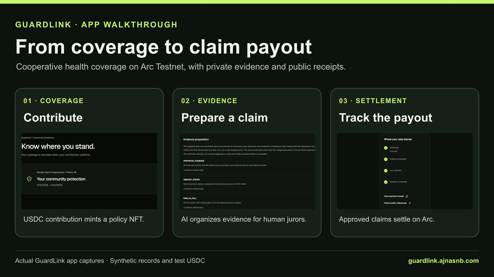
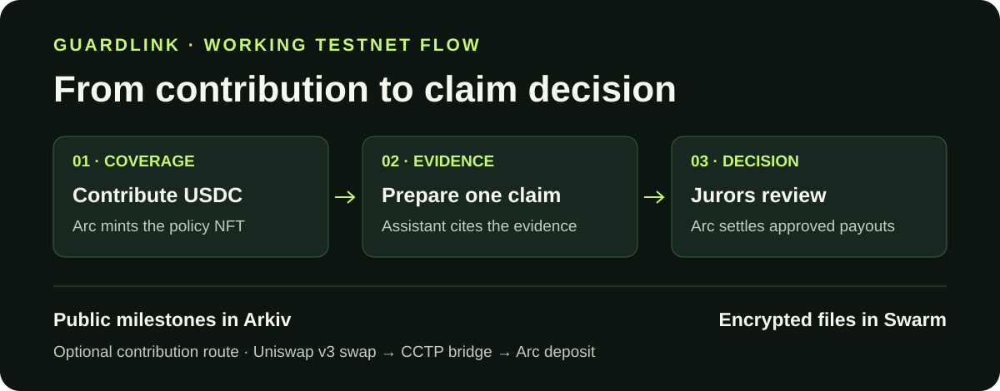
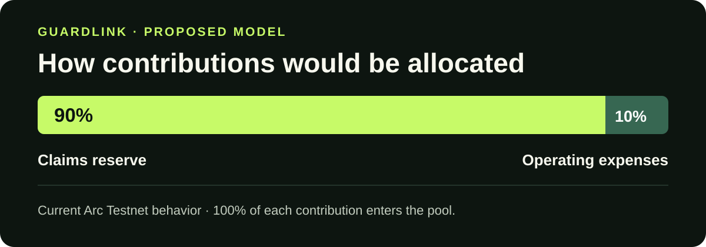

# GuardLink · Cooperative health coverage


**ETHGlobal Mumbai Continuity Track.** GuardLink brings an existing cooperative health coverage prototype to Arc Testnet. The new deployment demonstrates cooperative enrollment, USDC contributions, policy NFTs, private claim evidence, juror decisions, independent appeals and public payment receipts. It also demonstrates an optional Uniswap v3 contribution route and searchable public claim milestones. [ETHGlobal Showcase](https://ethglobal.com/showcase/guardlink-qcbtr) · [Open GuardLink](https://guardlink.ajnasnb.com/) · [Open the public Arc Studio preview](https://studio.arc.io/share/arc-integration-deployment-sandbox-5d41cde3zs) · [Explore the ledger](https://guardlink.ajnasnb.com/ledger/) · [Judge handoff](docs/ethglobal/SUBMISSION_HANDOFF.md)

After his father's eye surgery, the founder's family borrowed while waiting for reimbursement. When the payment arrived, it felt like a favour. That experience shaped GuardLink's focus on clear coverage, specific requests for missing documents and a visible path from decision to payment.

**Community outreach.** Over the past year, the founder reports reaching **10,000 people directly** and collecting **around 200,000 prospective contacts** through outreach. Conversations with women and families in Kerala's self-help communities helped shape the early prototype. That research, the cooperative coverage concept and the original prototype form the Continuity baseline. [Continuity baseline and provenance](docs/ethglobal/CONTINUITY_BASELINE.md)



[Full coverage screenshot](docs/ethglobal/assets/membership-04-policy.jpg) · [Full claim and payout screenshot](docs/ethglobal/assets/claim-evidence.jpg) · [Full Uniswap contribution screenshot](docs/ethglobal/assets/coverage-uniswap.jpg)



## The pool and policy NFT

The proposed contribution allocation is **90% for claims and 10% for operating expenses**. The Arc Testnet contract currently deposits **100%** of each contribution into the pool. Its separate treasury vote can authorize a one-off transfer of up to 10% of the free treasury after claim reservations, subject to the contract's rules. Approved claims can wait for funding when available liquidity is insufficient. [Deployed pool source](https://github.com/AjnasNB/GuardLink/blob/21db956247406eefe8b178509e50e1dccb951ddd/onchain/contracts/GuardLinkPool.sol)



A confirmed contribution mints a non-transferable policy NFT to the member's wallet. **My coverage** shows the policy number, term and remaining coverage. The contribution receipt records the mint and payment into the pool. The demo uses test USDC and synthetic records. [My coverage](https://guardlink.ajnasnb.com/app/coverage/) · [Example mint receipt](https://testnet.arcscan.app/tx/0xaec9d1fe84e65088f254b579f2d0025f976efc5008e31e09bc60db5478935ee1)

## Explore the public ledger

[Open the live GuardLink ledger](https://guardlink.ajnasnb.com/ledger/) without signing in. Switch between **Contributions**, **Claim payouts**, and **Treasury transfers**. Each confirmed event shows its transaction hash, UTC timestamp, block, sender, recipient, and test USDC amount. Open a hash, wallet, or block to check it independently on the Arc Testnet explorer.

| Recorded event | From → To | Test USDC | Arc receipt |
| --- | --- | ---: | --- |
| Contribution for Policy #4 | Member wallet → GuardLinkPool | 1.00 | [Block 71021366](https://explorer.testnet.arc.io/tx/0xaec9d1fe84e65088f254b579f2d0025f976efc5008e31e09bc60db5478935ee1) |
| Claim payout | GuardLinkPool → Member wallet | 0.25 | [View receipt](https://explorer.testnet.arc.io/tx/0xd49c157356415074b0351ca974740dfb4878fca95575eb28dc79fbfa8a157f63) |
| Claim payout after appeal | GuardLinkPool → Member wallet | 0.40 | [View receipt](https://explorer.testnet.arc.io/tx/0x9740c683d839971953d61afad540597c17ffee9a144864bc85e3ea1f271c7a99) |

The ledger is scoped to the [GuardLinkPool contract](https://explorer.testnet.arc.io/address/0x335D2CE0c397016ac0E1D6930EB98A1Dfe47c895?tab=token_transfers) and reads its public on-chain events. Private claim documents and member profiles stay in the authenticated workspace. [Public ledger API](https://guardlink.ajnasnb.com/api/v1/ledger/?kind=payouts)

The audit views work without a wallet. Open a proposal for its tally and quorum, then follow individual Arc vote receipts and the execution transaction. The case archive shows synced ballot counts, a link to Arc jury ballots, and Arkiv entity keys and SHA-256 digests of the exact public record payloads. Swarm references identify encrypted bytes. The archive shows the reference without offering the file. [Votes and decisions](https://guardlink.ajnasnb.com/ledger/votes/) · [Proposal #1](https://guardlink.ajnasnb.com/governance/proposals/1/) · [Sample Arkiv case](https://guardlink.ajnasnb.com/transparency/?caseId=dfd3e4f9-9008-4e60-b420-f10ae15c5f81)

## Make a test contribution

Anyone can try this with their own wallet on Arc Testnet. Set aside **1 test USDC plus transaction fees**. [Circle testnet faucet](https://faucet.circle.com/)

1. Select the funded account in MetaMask and choose **Continue with wallet** on [GuardLink sign-in](https://guardlink.ajnasnb.com/login/). If GuardLink is already open under a different address, choose **Continue as** with the selected address and sign the login message.
2. Open **My community**, read the cooperative's terms, and request membership. The operator verifies the same wallet on Arc.
3. Once verified, choose **Make a contribution** under **My coverage**. Confirm the test USDC approval if prompted, then confirm the contribution from the same account.
4. The confirmed contribution issues a policy NFT. Find it under **My coverage** and open its receipt under **Contributions** in the [public ledger](https://guardlink.ajnasnb.com/ledger/).


The fresh-wallet run checked the live API at each step, verified exactly 1 test USDC entering the pool, and checked NFT ownership on Arc and Policy #4 in the app. [Registration](https://testnet.arcscan.app/tx/0xa4d85966414f620d1a9963343cde8a414c193b71c9acc17793bf3c471f2dcd75) · [Operator verification](https://testnet.arcscan.app/tx/0xc0adce4f8d3a64f5d224218cf46a1c9874466c42bd62cf5bd1650beb72229e17) · [Contribution and mint](https://testnet.arcscan.app/tx/0xaec9d1fe84e65088f254b579f2d0025f976efc5008e31e09bc60db5478935ee1) · [Complete run](docs/ethglobal/membership-live.public.json)

## Who controls what?

| Action | Authority |
| --- | --- |
| Edit cooperative description and joining criteria | The cooperative operator edits the profile. The app records which criteria the applicant accepted. |
| Verify a member or appoint a claim panel | The designated operator signs on Arc. The pool enforces eligibility, excludes conflicts it can identify, and requires a separate appeal panel. |
| Add a policy for a member | A verified member signs a contribution. The pool mints the NFT to that wallet using current terms. |
| Change policy terms for future members and contributions | Verified members propose and vote on contribution, limit and term. Executed changes apply to future policies. An existing policy keeps its original terms. |
| Review evidence and resolve a claim | The AI evidence assistant prepares findings and flags missing items. Eligible human jurors sign the votes. The contract authorizes settlement after the required votes. |

The current demo runs one configured cooperative pool. Its policy terms form one active set per pool, with historical versions preserved in issued NFTs. The app currently has no product catalog for multiple simultaneous coverage tiers.

## Verified demo milestones

- **Enrollment:** Confirmed contributions include an optional swap-funded policy and a fresh-wallet enrollment. [Confirmed contributions](https://guardlink.ajnasnb.com/ledger/)
- **Evidence assistant:** On three authenticated, paid synthetic cases, the live API returned completed model recommendations. Case C returned five findings after a missing prescription was supplied under the same claim ID. This audit re-read those completed runs.
- **Decisions and payments:** Initial claims paid 0.50 and 0.25 test USDC. An independent appeal paid 0.40 test USDC. The audit matched recipients, amounts and claim IDs to chain receipts.
- **Governance:** Nine demo wallets voted to raise future coverage from 5 to 6 test USDC. The earlier policy retained its original 5 test USDC limit. Two later proposals from different demo wallets show split ballots for a coverage change and a treasury transfer. [Public proposals](https://guardlink.ajnasnb.com/governance/proposals/)
- **Privacy:** Assigned reviewers could retrieve evidence. Cross-member and unassigned-helper reads were denied. Public projections omit medical evidence and member identity.

[Live audit](docs/ethglobal/live-verification.json) · [Claim and governance receipts](docs/ethglobal/demo-run.public.json) · [Contract source verification](docs/ethglobal/source-verification.json)

## How the integrations fit


| Integration | What it does | How to check |
| --- | --- | --- |
| **Arc and Arc Studio** | Arc keeps the USDC reserve, policy issuance, voting authority and settlement independently verifiable in one contract. Arc Studio was the starting point for the contract. | [Active pool on ArcScan](https://testnet.arcscan.app/address/0x335d2ce0c397016ac0e1d6930eb98a1dfe47c895), [deployed pool source](https://github.com/AjnasNB/GuardLink/blob/21db956247406eefe8b178509e50e1dccb951ddd/onchain/contracts/GuardLinkPool.sol) |
| **Arkiv** | Public case milestones and governance can be queried by case without scanning every transaction. See **Follow the fund**. | [Arkiv implementation](worker/src/adapters/arkiv.ts), [schema and examples](arkiv/schema.md) |
| **Swarm** | Swarm holds encrypted evidence files. Arkiv stores the ciphertext reference. The Worker checks case access before retrieving and decrypting evidence. | [Swarm implementation](worker/src/adapters/swarm.ts), [upload and retrieval evidence](arkiv/swarm.md) |
| **Uniswap v3 and CCTP** | Members can start with a supported token while the cooperative settles in USDC. The verified route swaps WETH on Base Sepolia, bridges USDC with CCTP and deposits on Arc to mint policy #3. | [Route receipts and feedback confirmation](docs/ethglobal/CONVERSION_RUN.md), [Uniswap router call](scripts/contribution-route.mjs#L335), [coverage UI](frontend/components/ContributionRouteProof.tsx), [developer feedback](FEEDBACK.md) |

Blockchain makes wallet authority and movements from the shared reserve independently verifiable. Evidence still requires human judgment. The AI workflow organizes the case for reviewers and has no wallet, voting or payout authority. [Analysis workflow](worker/src/workflow.ts)

ETHGlobal lists the **$500 Arkiv + Swarm bonus for existing projects** under Arkiv. The bonus shares the Arkiv partner slot. The submission requests the bonus, and its postage batch attribution is still pending. [Official prize criteria](https://ethglobal.com/events/mumbai/prizes) · [Swarm evidence](arkiv/swarm.md)

The pinned deployment source matches the Arc Studio pull and the Solidity file returned by Sourcify for the live Arc Testnet pool. The timed payout challenge has its own contract version and test suite. [Arc Studio deployment evidence](docs/ethglobal/ARC_STUDIO_EVIDENCE.md) · [Timed payout review](docs/ethglobal/PAYOUT_REVIEW.md)

### Query Arkiv as a judge

The writer wallet is `0xd8E339b19353afDAF75EfeEdA7fDB88320420553` on Rabdi testnet (chain ID `7794095`). This [case A query](https://guardlink.ajnasnb.com/api/v1/transparency/?caseId=dfd3e4f9-9008-4e60-b420-f10ae15c5f81) requires no wallet.

```sh
curl -fsS 'https://guardlink.ajnasnb.com/api/v1/transparency/?caseId=dfd3e4f9-9008-4e60-b420-f10ae15c5f81'
```

Look for a paid milestone with the Arc receipt and an archive record with a ciphertext reference. `node scripts/verify-public-records.mjs` checks both public systems and the anonymous access boundary using Node.js 22 or later. [Arkiv judging files](arkiv/README.md) · [Swarm verification](arkiv/swarm.md) · [Arc Studio Continuity evidence](docs/ethglobal/ARC_STUDIO_EVIDENCE.md)

## Read the code

| Area | Start here |
| --- | --- |
| Member frontend | [Claim detail](frontend/components/ClaimDetail.tsx), [coverage and community workspace](frontend/components/Workspace.tsx) |
| API and evidence storage | [Worker routes](worker/src/index.ts), [encrypted Swarm adapter](worker/src/adapters/swarm.ts), [public Arkiv adapter](worker/src/adapters/arkiv.ts) |
| Evidence assistant | [Analysis workflow](worker/src/workflow.ts), [model adapter](worker/src/adapters/azure.ts), [claim and checklist rules](packages/domain/src/index.ts) |
| Reserve and settlement | [Arc contract](onchain/contracts/GuardLinkPool.sol), [architecture](docs/ethglobal/ARCHITECTURE.md) |

## Run locally

Use Node.js 22+ and npm. See the [demo runbook](docs/ethglobal/DEMO_RUNBOOK.md) for wallet roles, Arc Testnet settings and synthetic uploads. Keep credentials in ignored local configuration or Cloudflare secrets.

```sh
npm ci
npm run db:local -w worker
npm test
npm run typecheck
```

Start the API and web app in separate terminals with `npm run dev:api` and `npm run dev`. [Demo runbook](docs/ethglobal/DEMO_RUNBOOK.md) · [Contract tests](onchain/LOCAL_TESTING.md)

[Continuity baseline and provenance](docs/ethglobal/CONTINUITY_BASELINE.md) · [Submission and partner requirements](docs/ethglobal/SPONSOR_CHECKLIST.md) · [Asset sources](docs/ethglobal/assets/README.md)

The demo uses a designated operator for membership and panel assignment. Evidence encryption is server-managed, so the Worker and authorized analysis workflow can access plaintext. Real deployment would require a lawful insurance operating structure, actuarial pricing, reserve management, a consented pilot, and independent security review. Email OTP needs provider configuration and wallet-linking validation. Wallet sign-in is the tested path.

AI assisted code, artwork, test scaffolding and media preparation. The founder supplies the personal story and records the submission narration. Demo wallets are labelled role identities.

## Try the evidence assistant

1. In **My coverage**, confirm the demo wallet owns an active policy. Open **My claims → Start a claim**, choose that policy, and enter the synthetic incident date and requested amount. [Demo runbook](docs/ethglobal/DEMO_RUNBOOK.md)
2. Add the synthetic **hospital bill** and **discharge summary**. Select **Prepare my evidence**. The completeness score shows **2 of 3** and requests the prescription on the same claim ID. [Generate sample packets](scripts/make-claim-demo-packets.mjs)
3. Select **Add requested document** and upload the **prescription**. For a supplemental PDF, PNG or JPEG, choose **Other evidence** and enter a private document name. [Synthetic receipt image](fixtures/synthetic/payment-receipt.png)
4. Run **Prepare my evidence** again. Expand **Review AI findings** to see the case summary, unreadable or inconsistent evidence flagged by the assistant, and links to the relevant uploads. The score measures required document types. The assistant may surface an explicitly supported test USDC amount up to the claim request. The revised source withholds its suggestion when the amounts conflict. [Evidence review UI](frontend/components/EvidenceReview.tsx) · [Analysis code](worker/src/workflow.ts)
5. Send the case to the assigned human jurors for review. They open the cited evidence, compare it with the policy and record their decision. Arc enforces voting and settlement. Use the public ledger to verify an approved test payout. [Settlement code](onchain/contracts/GuardLinkPool.sol) · [Public ledger](https://guardlink.ajnasnb.com/ledger/)

To rehearse the full evidence flow against a local Worker with model analysis configured, load the private key of a dedicated verified test wallet into `GUARDLINK_DEMO_PRIVATE_KEY` in your shell. Use its policy ID and a covered date. The script checks the missing prescription, named image, access denial, cited findings and withheld amount on conflicting evidence. It stops at evidence review.

```sh
node scripts/rehearse-evidence.mjs <policy-id> fixtures/synthetic/payment-receipt.png <covered-iso-date>
```

[Rehearsal script](scripts/rehearse-evidence.mjs) · [Live synthetic case capture](docs/ethglobal/assets/claim-evidence.jpg) · [Asset sources](docs/ethglobal/assets/README.md)
