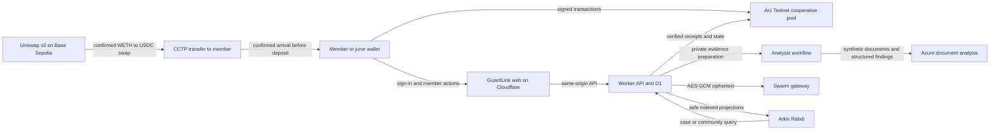

# GuardLink architecture

The cooperative contract enforces canonical USDC contributions, non-transferable policy coverage, eligible votes, capped payouts, disjoint appeals and prospective governance. A local helper is optional and cannot vote on the case they help with. The operator verifies demo membership and selects eligible panels; this is an explicit bootstrap dependency.

The API keeps a private case ID and verified wallet session. It checks ownership before document access, encrypts evidence before Swarm upload, and only returns plaintext after access checks. AI prepares a recommendation and follow-up requests; it has no signing authority. Separate Arc receipts authorize money and governed changes. Arkiv stores search-friendly status, agreement, governance and encrypted-file references without names, medical details or keys.

Arc fits because coverage reserves, payouts and transaction fees use USDC on the same EVM network. That simplifies the member's test wallet and preserves standard contract tooling. Base Sepolia serves the verified optional swap through an existing official Uniswap v3 WETH/USDC pool. The earlier Ethereum Sepolia mock route is retained as a fork rehearsal. The source and destination legs are separate; a quote, local fork receipt, or source swap cannot create Arc coverage.
