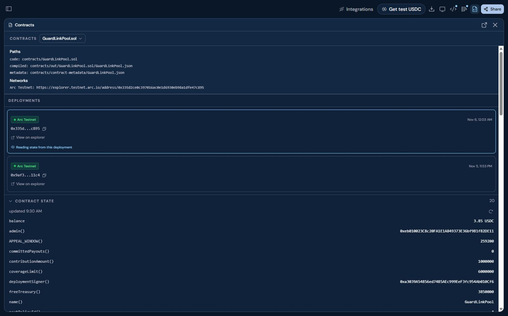

# Arc Studio deployment evidence

The [Arc Studio owner workspace](https://studio.arc.io/app/5b1cd267-eb2b-4f67-82cf-0f0d2b15252d) contains the contract implementation and deployment. The workspace URL redirected to sign-in in a signed-out browser. Judge access to that workspace still needs confirmation from Circle or ETHGlobal.

The active contract in the capture is [GuardLinkPool on Arc Testnet](https://testnet.arcscan.app/address/0x335d2ce0c397016ac0e1d6930eb98a1dfe47c895). Its [creation receipt](https://testnet.arcscan.app/tx/0x7e2bc3db994a3698ebd612e8d22dbd212b36b486f4f4f37dfccea4b62da78326) and [confirmed 0.25 test USDC payout](https://testnet.arcscan.app/tx/0xd49c157356415074b0351ca974740dfb4878fca95575eb28dc79fbfa8a157f63) are public. The [verified source evidence](source-verification.json) records the bytecode matches. [Open the live GuardLink testnet app](https://guardlink.ajnasnb.com).
