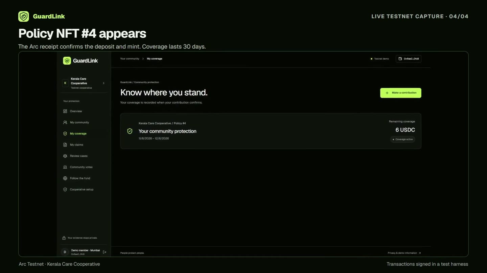
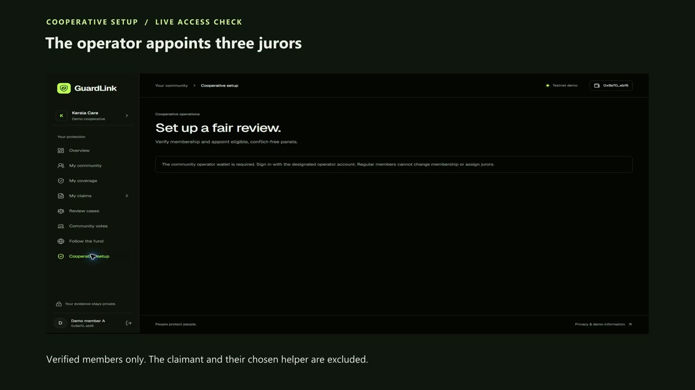
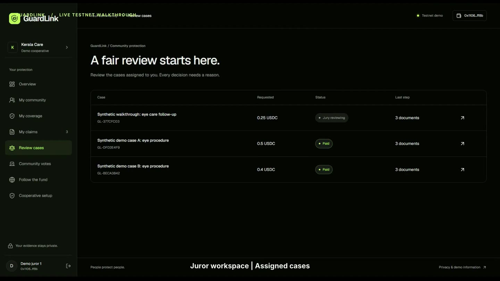
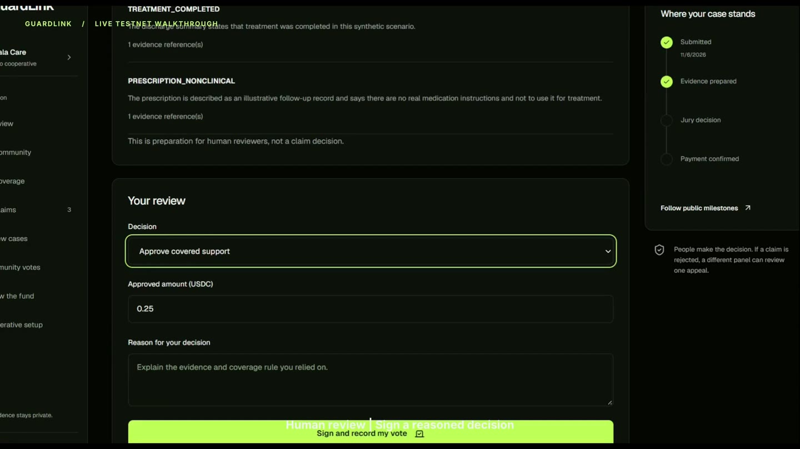
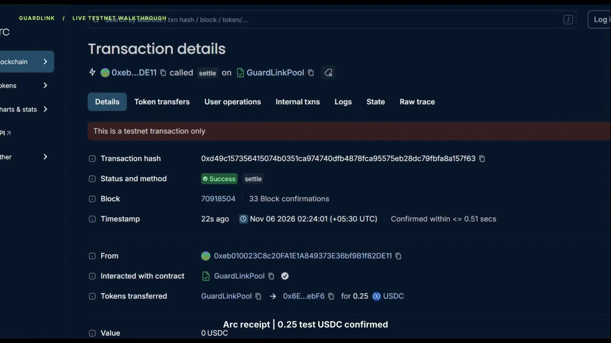
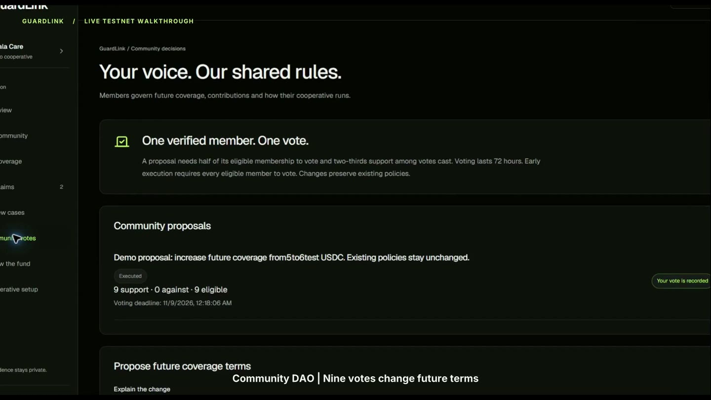

# GuardLink demo setup and recording guide

Use the completed Arc Testnet cases for the recording. Open the member view, a juror view, and the public proposal in separate windows. The images below are frames from the recorded demo. They show the screens to look for while you rehearse.

## 1. Open the existing demo wallets

On the Windows computer where the GuardLink wallets were prepared, open PowerShell and run:

```powershell
Set-Location -LiteralPath 'D:\eth global\guardchain.ai'
node scripts/open-demo.mjs member-a
```

Open `http://localhost:8899` in your **Member** Chrome profile within 60 seconds. The browser opens GuardLink as Demo member A. Check the name in the sidebar and the wallet ending `ebf6`. The one-use link signs you in using the existing encrypted wallet on this computer. It lets you view the member's cases and coverage. A live vote, contribution, or assignment needs a matching wallet signer.

For two windows at once, choose **Chrome profile → Add** and name the new profile **GuardLink Juror**. Run each command separately and open its link before running the next. Tabs inside one Chrome profile share the GuardLink login.

| Demo identity | Command | What to open |
| --- | --- | --- |
| Member A | `node scripts/open-demo.mjs member-a` | [My coverage](https://guardlink.ajnasnb.com/app/coverage/) and [paid claim](https://guardlink.ajnasnb.com/app/claims/377cfc03-c98d-4e89-bb99-178fd6811a2e/) |
| Juror 1 | `node scripts/open-demo.mjs juror-1` | [Review cases](https://guardlink.ajnasnb.com/app/review/) and the assigned case |
| Juror 2 | `node scripts/open-demo.mjs juror-2` | [Review cases](https://guardlink.ajnasnb.com/app/review/) and the second recorded decision |
| Member B | `node scripts/open-demo.mjs member-b` | [The paid appeal](https://guardlink.ajnasnb.com/app/claims/beca3842-52a4-4744-bde2-7033087bed3d/) |
| Appeal jurors | `node scripts/open-demo.mjs appeal-1`, then `appeal-2` or `appeal-3` in separate runs | [Review cases](https://guardlink.ajnasnb.com/app/review/) for the independent panel |
| Operator | Sign in with the wallet configured as the pool operator | [Cooperative setup](https://guardlink.ajnasnb.com/app/organizer/) |



## 2. Connect a wallet you control for a live transaction

1. Open the MetaMask account picker. Select and name the test account you want to use. For multiple active signers, open a separate Chrome profile for each role. Use the [MetaMask account picker guide with screenshots](https://support.metamask.io/configure/accounts/switching-accounts-in-metamask/).
2. Open [GuardLink sign-in](https://guardlink.ajnasnb.com/login/) and choose **Continue with a wallet**, or use **Use my connected wallet** from a demo session. Approve the Arc Testnet network prompt and sign the login message. Check that the address in the header matches the account you selected.
3. If MetaMask asks for the network manually, enter **Arc Testnet**, chain ID **5042002**, RPC `https://rpc.drpc.testnet.arc.io`, currency **USDC**, and explorer `https://testnet.arcscan.app`. The [MetaMask custom network guide](https://support.metamask.io/configure/networks/how-to-add-a-custom-network-rpc/) shows the form.
4. If you plan to send a transaction, get test USDC from the [Circle faucet](https://faucet.circle.com/). Request membership from **My community**. After operator verification, make a contribution from the same account. Each juror uses their own verified wallet and needs test USDC for network fees. A wallet must be verified at a proposal's eligibility snapshot to vote on that proposal.

The existing demo wallet is separate from your MetaMask test account. Use the local role launcher for the recording and your own test account for interactive wallet signing. If you need to act as the operator, use the already designated operator signer. A new member wallet does not become the operator by connecting.

## 3. Assign a jury as the operator

1. The claimant submits synthetic evidence, completes any request for a missing document, then signs **Send for review** to register the case on Arc.
2. Open **Cooperative setup → Jury assignments** with the operator wallet. Find the case by its `GL-` reference. The candidate count applies to that case. Pick three distinct verified members from the dropdowns. The claimant and their chosen helper are excluded. The appeal panel also excludes all three initial jurors.
3. Choose **Sign jury assignment**, approve the testnet transaction, and wait for confirmation. The assignment receipt identifies the round, panel wallet addresses and deadline. Review the [recorded original assignment](https://testnet.arcscan.app/tx/0x2f962237ccc95224af6438da71c22e141c26b09c4eff5b4ce8dd6bb29599a57f) or the [recorded independent appeal assignment](https://testnet.arcscan.app/tx/0x4ae99cad5fd729f600055c25f3aa82877c2d3a794c7e9bd27ff92cb99ec3254d).

This screenshot shows the permission check with a regular member session. Switch to the designated operator to see the roster and assignment form.



## 4. Review, vote and show the payment

1. In an assigned juror's window, open **Review cases** and match the case ID. In **Evidence preparation**, check which required documents are present, then expand **Review AI findings** and open the cited files to verify the findings. The readiness score counts required document types. Only authorized participants can open the files.
2. On an open case, review the evidence and enter a reason for the decision. For approval, enter the amount. Choose **Sign and record my vote**. A juror can vote once in that round.
3. Use the other juror window to show the second decision. Two matching approvals for the same amount authorize settlement. Two rejection votes reject the case. The member can see recorded decisions in **How reviewers decided**. Follow the [payment receipt](https://testnet.arcscan.app/tx/0xd49c157356415074b0351ca974740dfb4878fca95575eb28dc79fbfa8a157f63) or the [public ledger](https://guardlink.ajnasnb.com/ledger/).
4. For the recording, use the saved vote-form clip and the completed case. The live test case already paid. Use Member B's separate case to show what an independent appeal looks like.







## 5. Show a DAO proposal

1. Open [Public proposals](https://guardlink.ajnasnb.com/governance/proposals/) in a clean window. Open the executed proposal to show the tally, quorum and receipt.
2. For a new proposal, open **Community votes → New proposal** with a verified member wallet. Add the title, summary, reason, impact and conflicts, then preview and sign.
3. On an open proposal, choose **Vote in support** or **Vote against**, review your choice and sign. GuardLink requires half of eligible members, rounded up, and at least two-thirds support among votes cast. Execute an approved proposal when the contract makes execution available.
4. In the demo, nine members voted to increase future coverage from five to six test USDC. Existing policies kept their original terms. The screenshot shows the completed vote in the recorded walkthrough.



Arbitrum's public proposal and voting surfaces inspired this layout. GuardLink uses one direct vote per eligible member and a separate appointed jury for claims. Once the roster is large enough, a future version can add opt-in jury availability, audited rotation and conflict review. Revocable delegation is a separate idea for policy proposals. See the [Arbitrum proposal process](https://docs.arbitrum.foundation/how-tos/create-submit-dao-proposal).
